# 音楽電車 Ongaku Densha

**Your year of listening, told as one train ride through Japan.**

A browser story built from your own streaming history: 13 stations, each one a different corner of Japanese pop culture, each one carrying a real number from your data. Phone first. Nothing is uploaded.

> **Status: under development.** The ride works end to end and is tested on a phone, but it is not finished. The name is a working name. See [Roadmap](#roadmap).

> **Not affiliated with Spotify.** There is no Spotify name or logo in the product. It only reads the history files you export from your own account.

Live: https://mathblender17.github.io/MySpotifyWrapped/

---

## The ride

Thirteen stops, spring to New Year's midnight. Every station has its own visual world; the route map, the ticket, the station sign and the gyaru guide's flip phone stay the same so it still feels like one train.

| # | Station | Shows | World |
|---|---|---|---|
| 1 | 出発 Departure | Pick a year | Station wayfinding signs |
| 2 | 鳥居 Torii Gates | Days and minutes listened | Mega type and the rising sun |
| 3 | 弁当 Bento | Genre mix *(needs genres)* | Sports newspaper |
| 4 | ガングロ Ganguro | Top genre *(needs genres)* | Y2K chrome and flip phones |
| 5 | 番付 Banzuke | Top 5 artists | Manga panels and screentone |
| 6 | 推し Oshi | Your #1 artist | Gyaru magazine cover |
| 7 | コンビニ Konbini | Top songs, as a receipt | Neon riso print |
| 8 | ガチャ Gacha | Your #1 song reveal | JRPG pixel menus |
| 9 | 天気 Forecast | Your four seasons | 1960s modernist poster |
| 10 | 富士 Fuji | Your peak listening week | Sumi ink painting |
| 11 | 新幹線 Shinkansen | The fastest riser of the year | Showa kaiju movie poster |
| 12 | おみくじ Omikuji | Your listener personality and fortune | Ink calligraphy slip |
| 13 | 今年の漢字 Kanji | Your year in one kanji, as a share card | Mega kanji and a stamped ticket |

Bento and Ganguro are skipped (shown as grey 通過🔒 stops) until genre data is available.

### Screenshots

Captured at phone size from the built app.

| | | |
|---|---|---|
| 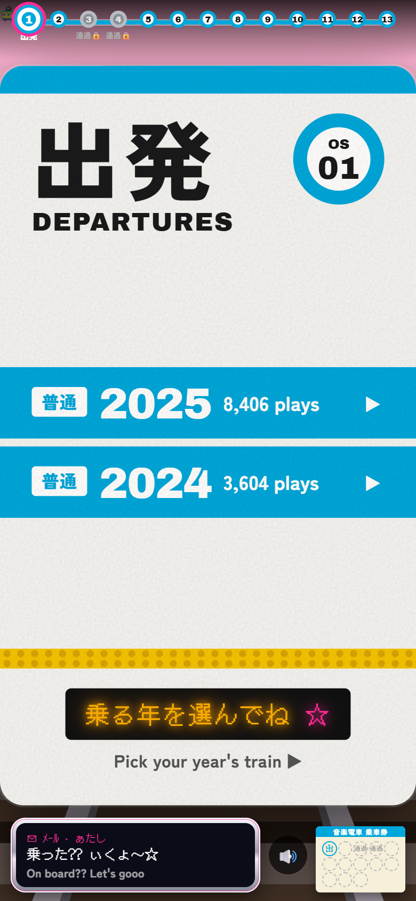 | 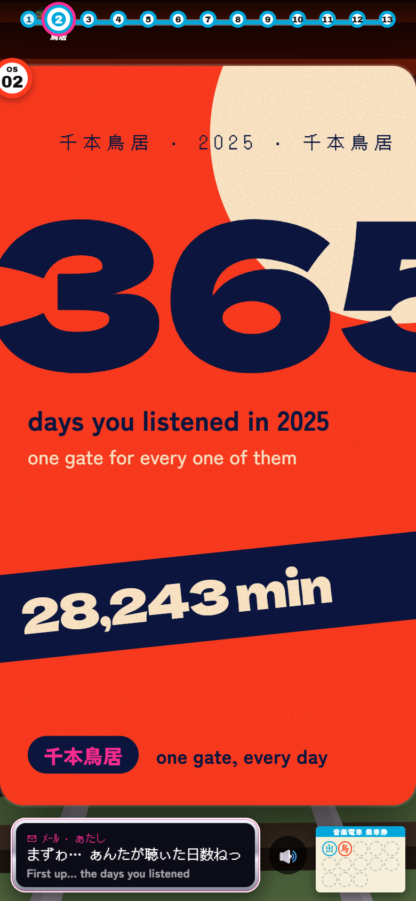 | 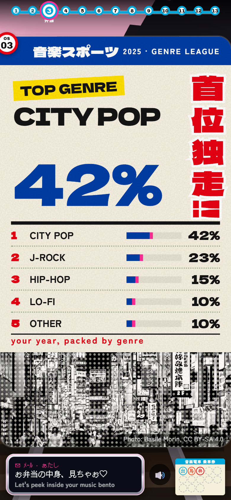 |
| Departure | Torii Gates | Bento |
| 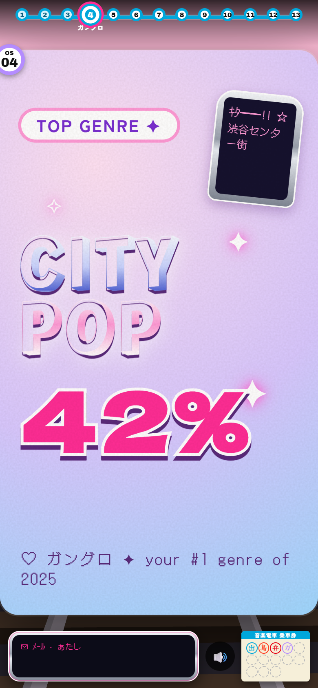 | 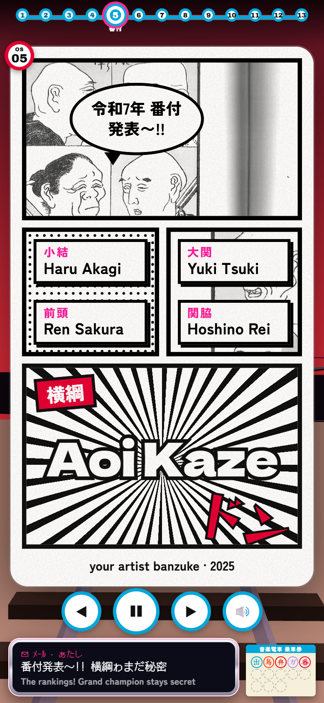 | 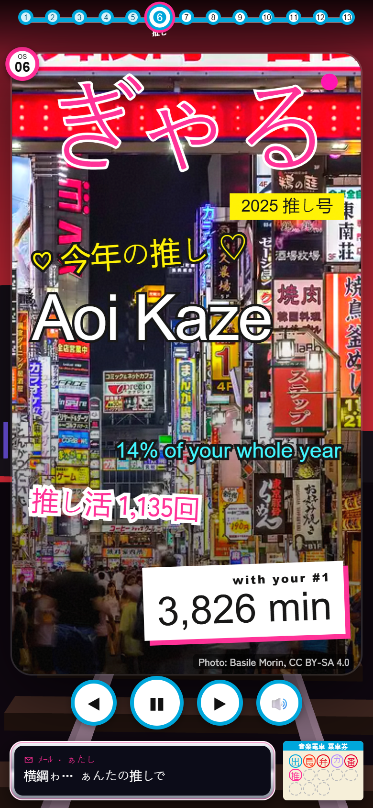 |
| Ganguro | Banzuke | Oshi |
| 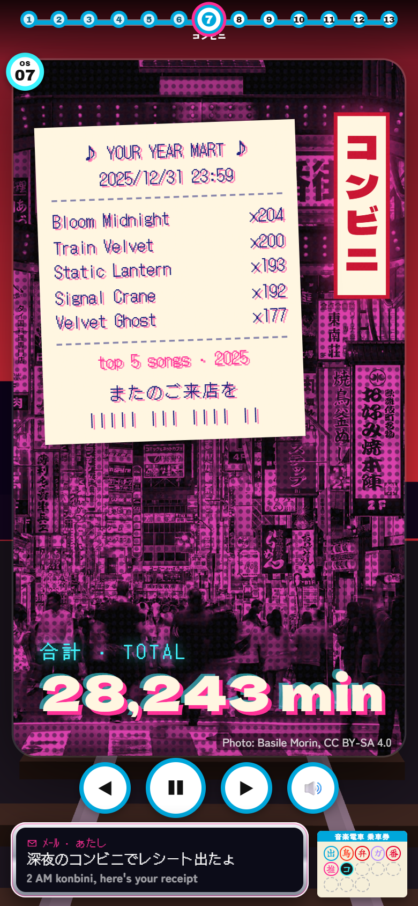 | 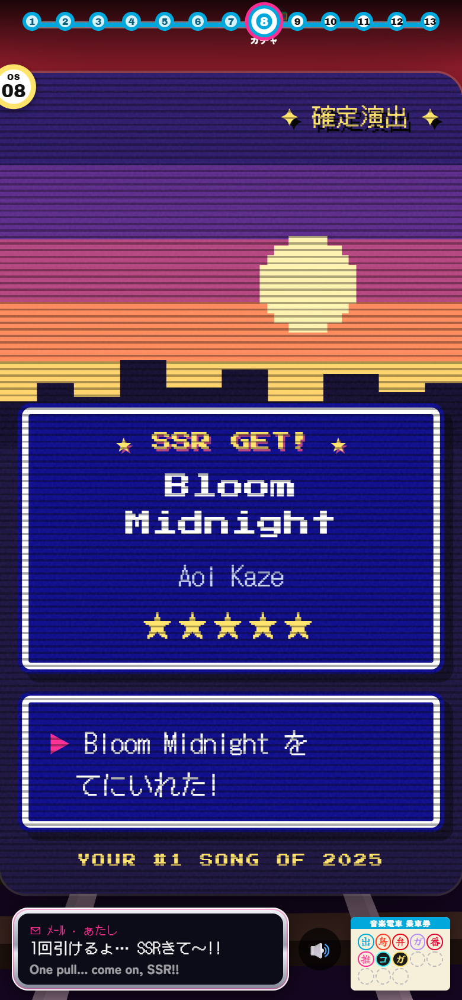 | 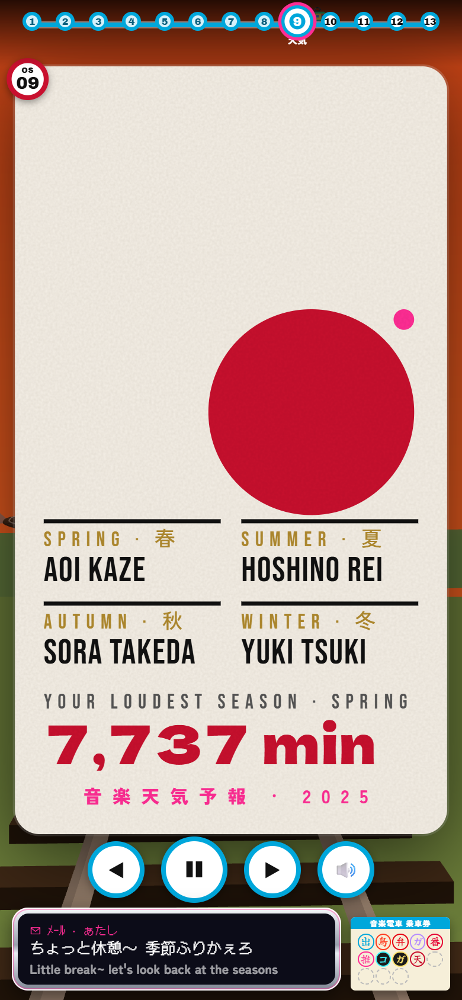 |
| Konbini | Gacha | Forecast |
| 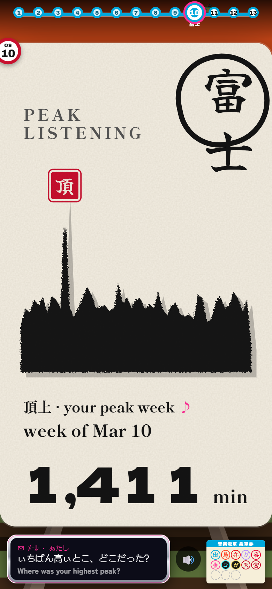 | 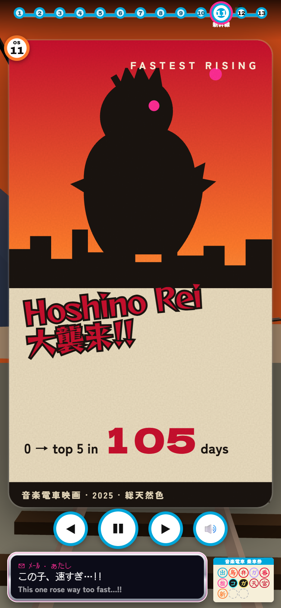 | 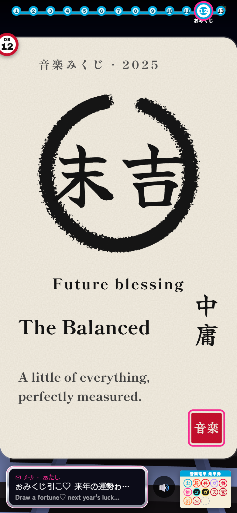 |
| Fuji | Shinkansen | Omikuji |
| 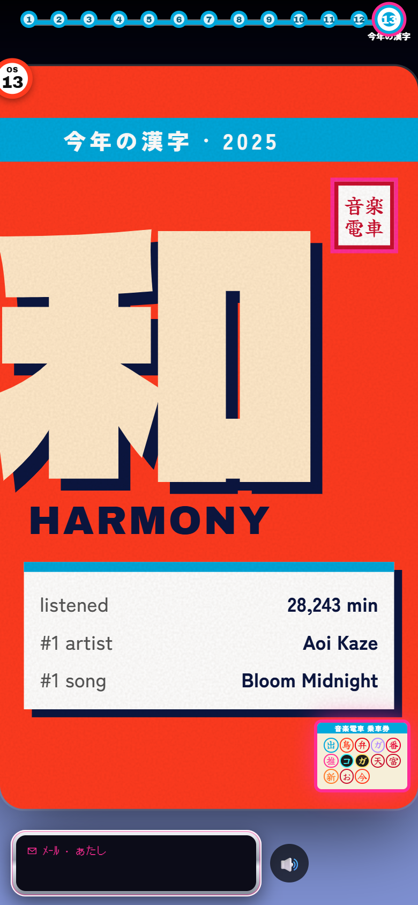 | | |
| Kanji | | |

---

## Made for phones

- **Visible controls:** Back, Pause and Next buttons, each at least 48 px.
- **Gestures:** tap right to go forward, tap left to go back, swipe left or right to move, swipe down or press and hold to pause.
- **Reading time:** every card holds for 6 to 10 seconds depending on how much text it has, and the timer freezes while you touch the card.
- **Cards stay alive:** after a card finishes animating, its world keeps a quiet idle loop going.
- **Touch every station:** most cards have one thing to poke, marked by a small pulsing dot. Recount the torii, zoom a banzuke panel, play your Oshi's song, pull the gacha again, drag the sun through the seasons, drag along the Fuji ridge, shake for an omikuji, flip the finale ticket over.
- **A non-stop mix:** your top songs play as a continuous mix with crossfades, and a station's own song takes over when you arrive.
- **Haptics** on Android (short taps on arrivals and stamps). iPhones do not support web vibration.
- **Reduced motion** is respected: no idle loops, no vibration, interactions switch to instant.

## Your data stays on your device

- Drop in your export and everything is computed in your browser.
- Real exports are never part of this repository (`fixtures/private/` is git-ignored). The sample files in `fixtures/` are made-up.
- The only thing that leaves your device is an **artist and song name**, sent to Apple's public iTunes search to find a 30-second preview clip for the soundtrack.
- IP addresses and device details in the export are dropped when it is read, and private-session plays are left out.

### What it reads

- **Account data** export: `StreamingHistory*.json`.
- **Extended streaming history** export: `Streaming_History_Audio_*.json`, the full lifetime history. What is in it and what can be inferred from it is catalogued in [docs/data/extended-history-catalogue.md](docs/data/extended-history-catalogue.md).
- **Demo data** if you have no file yet.
- Plays under 30 seconds do not count as plays, the same threshold Spotify uses.

---

## Influences

### Japan, as texture

The whole thing is a tour of Japan. Japanese is used as texture, with English alongside it. It is not translation-only and not decoration-only. Mixed into it is the garbled **gyaru-moji** text style of early-2000s Japanese phone messages, spoken by a gyaru guide on a flip phone.

### Subcultures and genres we picked from

Forty-five were explored across three rounds ([docs/design/subcultures](docs/design/subcultures/README.md)). The ones in the ride or still on the shelf:

- **Street and youth:** gyaru, ganguro and yamanba, keitai deco-mail, Harajuku, yankii and sukeban, purikura, bosozoku and dekotora
- **Pop and fandom:** idol and oshi-katsu, the Kōhaku year-end song battle, otaku and Akihabara maid cafés, fighting-game VS screens, JRPG menus, gacha, super sentai
- **Sport and school:** sumo banzuke, Kōshien high-school baseball, shōnen manga reader polls
- **Everyday life:** trains and station wayfinding, konbini receipts, bento, vending machines, station stamp rallies, kaiten sushi, izakaya
- **Season and ritual:** TV weather and sakura forecasts, omikuji fortune slips, matsuri, kanji of the year, torii gates, Mt. Fuji postcards, kintsugi
- **Retro Japan:** city-pop vinyl with obi strips, Showa kaiju movie posters, 1960s Japanese modernism
- **Classic Japan:** samurai scrolls, maiko, maneki-neko, senbazuru, zen rock gardens, mecha HUDs

### The look

Eleven visual worlds were chosen from 19 directions explored ([docs/design/art-direction](docs/design/art-direction/README.md)): station wayfinding, mega type, sports newspaper, Y2K keitai chrome, shōnen manga, gyaru magazine cover, neon riso, JRPG pixel, 1960s modernism, sumi ink and kaiju poster. Two more (ukiyo-e zine and Great Wave mega-crop) were explored but are not in the ride. The rules that hold it together are in the [art direction spec](docs/superpowers/specs/2026-10-25-art-direction-design.md).

### The format

The idea of "your year, as a story you can share" comes from year-in-review recaps like Spotify Wrapped. This project borrows the format and nothing of the branding.

---

## Pictures and credits

The ride itself uses **two found pictures**. The other pictures in `docs/design/art-direction/img/` were used while exploring directions and are not shown in the app.

| Picture | Where it is used | Creator | Licence |
|---|---|---|---|
| [*Kabukicho red gate and colorful neon street signs at night*](https://commons.wikimedia.org/w/index.php?curid=81420139) | Bento (halftone), Oshi (cover photo), Konbini (duotone) | Basile Morin, via Wikimedia Commons | **CC BY-SA 4.0**, recoloured and halftoned here; those altered versions stay under CC BY-SA 4.0 |
| [*Hokusai Manga* vol. 5](https://commons.wikimedia.org/wiki/File:Hokusai_Manga_05.jpg) | Banzuke (manga panel crops) | Katsushika Hokusai (early 19th century), via Wikimedia Commons | Public domain |

The Kabukicho credit is shown on every slide that uses the photo.

Used while exploring (not in the app):

| Picture | Creator | Licence |
|---|---|---|
| [*Shinagawa*, from Fifty-three Stations of the Tōkaidō](https://commons.wikimedia.org/wiki/File:Utagawa_Hiroshige_I_-_Shinagawa_(from_the_series_Fifty-three_Stations_of_the_Tokaido)_-_1942.146_-_Cleveland_Museum_of_Art.tiff) | Utagawa Hiroshige I (1833 to 1836), Cleveland Museum of Art via Wikimedia Commons | CC0 |
| [*Kabuki Actor Ōtani Oniji III as Yakko Edobei*](https://www.metmuseum.org/art/collection/search/37358) | Tōshūsai Sharaku (1794), The Metropolitan Museum of Art | CC0 |
| [*Under the Wave off Kanagawa*](https://commons.wikimedia.org/w/index.php?curid=88691109) | Katsushika Hokusai (1831), via Wikimedia Commons | CC0 |
| [*Kuki Chōchin Matsuri 04*](https://commons.wikimedia.org/w/index.php?curid=150505880) | Ocdp, via Wikimedia Commons | CC0 |

Full records (titles, links, licences) are in [docs/design/art-direction/img/credits.json](docs/design/art-direction/img/credits.json). Everything else on screen (patterns, the train, the kaiju, the sun, the shapes) is drawn in code.

### Typefaces

All from Google Fonts, loaded on demand: Archivo Black, Dela Gothic One, DotGothic16, Yuji Syuku, Zen Kaku Gothic New, Zen Maru Gothic, Rampart One, Reggae One, Hachi Maru Pop, Anton, Press Start 2P, Bebas Neue and Shippori Mincho. They are used under their own open font licences.

### Sound and 3D

- Sound effects (stamp, chime, rumble and so on) are synthesised in the browser. No sample files.
- Song previews are 30-second clips from Apple's iTunes search, played for the song the stat is about.
- The 3D train world is built in code with three.js, using plain low-poly shapes.

---

## Run it

```bash
npm install
npm run dev      # http://localhost:5173
npm test         # vitest
npm run build    # type-check and build to dist/
```

Handy dev URL parameters: `?data=demo`, `?genres=sample` (fake genre data to unlock Bento and Ganguro), `?station=N`, `?year=2025`, `?reduced=1`, `?previews=silent`.

Built with Vite, TypeScript, GSAP and three.js. A GitHub Actions workflow publishes `main` to GitHub Pages.

## Roadmap

- [x] Data core: demo, account export and extended export, plus all stats
- [x] The 3D world, camera, transitions, guide, ticket and soundtrack
- [x] Art direction: eleven visual worlds
- [x] Alive ride: a non-stop mix, readable pacing, phone controls, swipes, haptics
- [x] Touch interactions on the stations
- [ ] Genres from Last.fm, which unlocks Bento and Ganguro
- [ ] Share image export
- [ ] The all-years story and extra stops
- [ ] More themes

## Docs

- Specs and plans: [docs/superpowers](docs/superpowers)
- Design exploration: [docs/design](docs/design)
- Data catalogue: [docs/data](docs/data/extended-history-catalogue.md)

## Licence

Code licence not chosen yet. The pictures keep the licences listed above.
